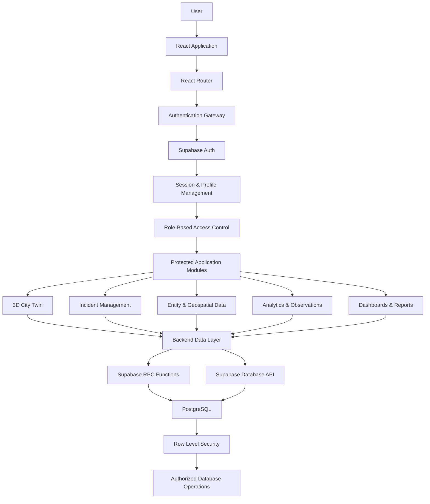
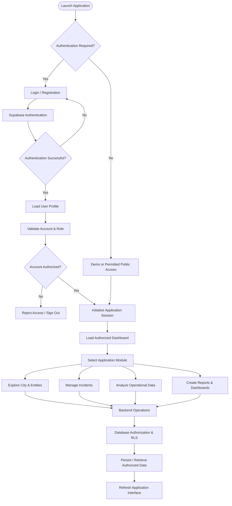
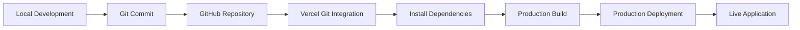

# NEXUS // OMNIVERSE

### A Unified Intelligence, Geospatial & City Operations Platform

<p align="center">

**Visualize. Investigate. Analyze. Coordinate.**

An interactive city intelligence platform bringing together 3D geospatial visualization, incident management, operational analytics, reporting, and secure role-based access control.

</p>

<p align="center">

[](https://react.dev/)
[](https://www.typescriptlang.org/)
[](https://vite.dev/)
[](https://supabase.com/)
[](https://www.postgresql.org/)
[](https://vercel.com/)
[](./LICENSE)

</p>

<p align="center">

**Live Application:** https://nexus-omniverse-iota.vercel.app

**Repository:** https://github.com/Akshatbhati31/nexus-omniverse

</p>

---

## Table of Contents

- [Overview](#-overview)
- [Core Objectives](#-core-objectives)
- [Key Features](#-key-features)
- [System Architecture](#-system-architecture)
- [Application Workflow](#-application-workflow)
- [Technology Stack](#-technology-stack)
- [Project Structure](#-project-structure)
- [Database Architecture](#-database-architecture)
- [Security Architecture](#-security-architecture)
- [Installation](#-installation-and-setup)
- [Environment Configuration](#-environment-configuration)
- [Development](#-development)
- [Testing](#-testing-and-validation)
- [Deployment](#-deployment)
- [Roadmap](#-roadmap)
- [Contribution Guidelines](#-contribution-guidelines)
- [Project Information](#-project-information)
- [License](#-license)

---

## 🌐 Overview

**NEXUS // OMNIVERSE** is a modern intelligence and city operations platform designed to bring multiple operational capabilities into a unified digital environment.

The platform combines geospatial visualization, entity exploration, incident tracking, operational analytics, customizable dashboards, and reporting into a centralized interface.

Instead of working across disconnected operational tools, users can interact with different information modules through a common application environment.

NEXUS is designed around the concept of a digital operations centre: a centralized interface where information can be visualized, incidents can be managed, relationships can be explored, and operational activities can be monitored.

### The Vision

To build a unified digital environment that makes complex operational information easier to visualize, understand, and manage.

### Intended Users

- Intelligence and data analysts
- City operations teams
- Infrastructure monitoring teams
- Incident response coordinators
- Administrative personnel
- Organizations managing geospatial and operational information

*The platform is an independent software project. Its interfaces do not imply official integration with government, police, emergency services, or live city infrastructure.*

---

## 🎯 Core Objectives

| Objective | Description |
|---|---|
| Centralization | Bring multiple operational modules into one interface. |
| Visualization | Represent geographical and operational information visually. |
| Investigation | Explore entities, relationships, and observations. |
| Coordination | Track incidents and coordinate assignments. |
| Analytics | Present operational information through dashboards and charts. |
| Reporting | Organize and share structured operational reports. |
| Security | Apply authentication and role-based access restrictions. |

---

## 🚀 Key Features

### 1. 3D City Digital Twin

An interactive geospatial visualization environment designed to represent city-level information.

Capabilities include:
- 3D city visualization.
- Spatial navigation and exploration.
- Geographical location representation.
- Integration of entity and location information.
- A centralized spatial interface for operational data.

### 2. Geospatial Intelligence

Explore geographical information and its relationship with operational entities.

- Location-based information.
- Entity positioning.
- Spatial relationships.
- Observation visualization.
- Geographical context for operational activities.

### 3. Entity & Relationship Exploration

A structured environment for examining entities and their connections.

- Entity records.
- Relationship mapping.
- Observation records.
- Connected information exploration.
- Centralized entity data management.

### 4. Incident Management

A dedicated module for managing operational incidents throughout their lifecycle.

- Incident creation and tracking.
- Incident status transitions.
- Team assignments.
- Incident event history.
- Operational updates.
- Incident-related information management.

### 5. Analytics & Observations

Transform stored operational information into more understandable visual representations.

- Data visualization.
- Analytical charts.
- Observation records.
- Operational summaries.
- Information exploration.

### 6. Custom Dashboards

A configurable dashboard environment for organizing operational information.

- Dashboard creation.
- Widget management.
- Dashboard layout persistence.
- Structured widget positioning.
- User-specific dashboard management.

### 7. Reports & Documentation

A reporting environment for organizing and managing operational information.

- Report creation.
- Report metadata management.
- Report blocks.
- Report classification and status.
- Controlled report access.
- Report sharing functionality where supported by permissions.

### 8. Authentication & Access Control

A dedicated authentication and authorization layer.

- User registration and login.
- Session management.
- Profile synchronization.
- Role-based permissions.
- Protected application access.
- Database-enforced access restrictions.

### 9. Audit & Operational Security

Security-oriented backend operations designed to improve accountability.

- Audit logging.
- Controlled incident operations.
- Protected RPC functions.
- Row Level Security.
- Restricted administrative operations.

---

## 🏗️ System Architecture

NEXUS follows a layered architecture separating the user interface, application state, authentication, backend operations, and persistent data.

### High-Level Architecture



### Architecture Layers

| Layer | Responsibility |
|---|---|
| Presentation | React-based user interface and interactive components. |
| Routing | Navigation and protected application routes. |
| State Management | Application and session state through Zustand. |
| Authentication | User authentication and session lifecycle. |
| Authorization | Role-based access and permission validation. |
| Backend Integration | Supabase queries and controlled RPC operations. |
| Database | PostgreSQL data persistence. |
| Security | Row Level Security and database authorization policies. |

---

## 🔄 Application Workflow

The following flow represents the intended authenticated user journey.



---

## 🛠️ Technology Stack

NEXUS uses a modern frontend and backend technology stack.

| Technology | Purpose |
|---|---|
| React 19 | Component-based user interface |
| TypeScript | Type safety and maintainable code |
| Vite | Development server and build tooling |
| Tailwind CSS 4 | Utility-first styling |
| Zustand | Application state management |
| React Router | Application navigation |
| Three.js | 3D graphics |
| React Three Fiber | React integration for Three.js |
| Recharts | Data visualization |
| Framer Motion | UI animations |
| Supabase | Authentication and backend services |
| PostgreSQL | Relational database |
| Vercel | Frontend deployment |
| Vitest | Automated testing |

---

## 📁 Project Structure

The repository is organized to separate application functionality, reusable components, state management, and database infrastructure.

```text
nexus-omniverse/
│
├── public/
│   └── Static assets
│
├── src/
│   ├── components/
│   │   ├── ui/
│   │   ├── layout/
│   │   ├── three/
│   │   └── Reusable interface components
│   │
│   ├── pages/
│   │   └── Application pages and modules
│   │
│   ├── lib/
│   │   ├── auth.ts
│   │   ├── backend.ts
│   │   └── Backend and authentication utilities
│   │
│   ├── store/
│   │   └── Zustand application stores
│   │
│   ├── test/
│   │   └── Automated tests
│   │
│   ├── App.tsx
│   └── Main application entry points
│
├── supabase/
│   ├── migrations/
│   │   ├── 0001_schema.sql
│   │   ├── 0002_rls.sql
│   │   ├── 0003_realtime_views.sql
│   │   ├── 0004_security_hardening.sql
│   │   └── 0004_rollback.sql
│   │
│   ├── neon_test_bootstrap.sql
│   └── neon_security_runtime_test.sql
│
├── .env.example
├── .gitignore
├── index.html
├── package.json
├── package-lock.json
├── tsconfig.json
├── vite.config.ts
└── README.md
```

*Directory descriptions are representative; consult the repository for the complete current structure.*

---

## 🗄️ Database Architecture

NEXUS uses PostgreSQL through Supabase for persistent application data.

The database is organized around operational records, user identity, permissions, geospatial information, incidents, dashboards, and reporting.

### Core Database Entities

| Entity | Purpose |
|---|---|
| profiles | User profile information |
| roles | Application role definitions |
| permissions | Permission definitions |
| role_permissions | Role-to-permission relationships |
| workspaces | Workspace organization |
| workspace_members | Workspace membership |
| entities | Operational entity records |
| locations | Geographical information |
| entity_relations | Relationships between entities |
| observations | Operational observations |
| incidents | Incident records |
| incident_events | Incident event history |
| incident_assignments | Incident team assignments |
| incident_evidence | Incident evidence |
| dashboards | Dashboard definitions |
| dashboard_widgets | Dashboard widget records |
| reports | Report records |
| report_blocks | Report content blocks |
| audit_logs | Audit information |

### Database Migrations

| Migration | Responsibility |
|---|---|
| `0001_schema.sql` | Initial database schema and core tables. |
| `0002_rls.sql` | Row Level Security policies and authorization helpers. |
| `0003_realtime_views.sql` | Realtime configuration and database views. |
| `0004_security_hardening.sql` | Additional authorization controls, hardened RPC operations, and security policies. |
| `0004_rollback.sql` | Recovery script associated with the security-hardening migration. |

**Important:** Apply migrations only in the intended database environment and in the correct order. The rollback script is a recovery artifact, not a routine deployment step.

---

## 🔐 Security Architecture

Security is implemented across the application and database layers.

### Authentication

Supabase Auth manages user authentication and session handling.

The frontend integrates authentication through a dedicated authentication layer.

### Role-Based Access Control

The application uses role-based permissions to control access to operational capabilities.

### Row Level Security

PostgreSQL RLS policies enforce access restrictions at the database level.

This provides an additional authorization boundary beyond frontend route protection.

### Controlled Database Operations

Sensitive operations are handled through controlled database functions rather than unrestricted frontend mutations.

Examples include:
- Incident transitions.
- Incident assignments.
- User role management.
- Audit logging.
- Dashboard persistence.
- Report persistence.

### Credential Management

Public frontend configuration uses environment variables.

Secret keys must never be embedded in frontend code or committed to the repository.

---

## 💻 Installation and Setup

### Prerequisites

Install the following:

- Node.js (compatible with the project's Vite requirements).
- npm.
- Git.
- A Supabase project for live backend functionality.

### 1. Clone the Repository

```bash
git clone https://github.com/Akshatbhati31/nexus-omniverse.git
```

### 2. Navigate to the Project

```bash
cd nexus-omniverse
```

### 3. Install Dependencies

```bash
npm install
```

### 4. Configure Environment Variables

Create a `.env` file in the project root.

```env
VITE_SUPABASE_URL=your_supabase_project_url
VITE_SUPABASE_ANON_KEY=your_supabase_publishable_or_anon_key
VITE_NEXUS_DEMO_MODE=false
```

Replace the placeholders with the appropriate values from your Supabase project.

Never expose a Supabase service-role key in frontend environment variables.

### 5. Start the Development Server

```bash
npm run dev
```

Open the local URL displayed in the terminal.

---

## ⚙️ Environment Configuration

| Variable | Description |
|---|---|
| `VITE_SUPABASE_URL` | Supabase project URL |
| `VITE_SUPABASE_ANON_KEY` | Supabase publishable or legacy anon key |
| `VITE_NEXUS_DEMO_MODE` | Enables or disables demo mode where supported |

All variables prefixed with `VITE_` are exposed to the browser bundle. Never put private credentials in them.

---

## 🧪 Testing and Validation

Run the available validation commands from the project root.

### Type Checking

```bash
npm run typecheck
```

### Automated Tests

```bash
npm run test
```

### Linting

```bash
npm run lint
```

### Production Build

```bash
npm run build
```

These commands help verify type correctness, automated test behavior, code quality, and production build compatibility.

---

## 🚀 Deployment

NEXUS is deployed using Vercel with GitHub integration.

### Production Application

**https://nexus-omniverse-iota.vercel.app**

### Deployment Workflow



### Deployment Steps

1. Push the latest changes to the connected GitHub branch.
2. Open the Vercel project.
3. Configure the required environment variables.
4. Verify the build configuration.
5. Trigger or allow the automatic deployment.
6. Verify the production application.

**Build command:** `npm run build`

**Output directory:** `dist`

---

## 🗺️ Roadmap

Potential areas for continued development:

- [ ] Expanded real-time operational data integrations.
- [ ] Advanced geospatial visualization.
- [ ] More comprehensive incident analytics.
- [ ] Enhanced reporting capabilities.
- [ ] Additional dashboard customization.
- [ ] Expanded administrative tooling.
- [ ] Improved operational notifications.
- [ ] Additional automated security tests.
- [ ] Enhanced documentation and deployment workflows.

Roadmap items represent potential future development, not necessarily existing functionality.

---

## 🤝 Contribution Guidelines

NEXUS // OMNIVERSE is an independently maintained proprietary project.

Contributions, suggestions, and technical discussions may be proposed to the project maintainer.

Submitting a suggestion or contribution does not grant permission to reuse, distribute, or commercially exploit the software.

Any authorized contribution or collaboration must follow the maintainer's approval and applicable written terms.

---

## 📌 Project Information

| Field | Details |
|---|---|
| Project | NEXUS // OMNIVERSE |
| Category | Intelligence & City Operations Platform |
| Maintainer | Akshat Bhati |
| Copyright Owner | Akshat Bhati |
| Repository | [GitHub](https://github.com/Akshatbhati31/nexus-omniverse) |
| Live Application | [Production](https://nexus-omniverse-iota.vercel.app) |
| Deployment | Vercel |
| Backend | Supabase |
| Database | PostgreSQL |
| License | Proprietary — All Rights Reserved |

---

## 📜 License

**Copyright © 2026 Akshat Bhati. All Rights Reserved.**

NEXUS // OMNIVERSE is proprietary software.

No permission is granted to copy, modify, distribute, sublicense, publish, or commercially exploit this software without prior written authorization from the copyright owner.

See the [`LICENSE`](./LICENSE) file for the complete license terms.

---

<p align="center">

**NEXUS // OMNIVERSE**

*One Platform. Unified Intelligence. Connected Operations.*

</p>

<p align="center">
Maintained by **Akshat Bhati**
</p>
